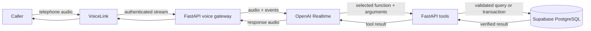
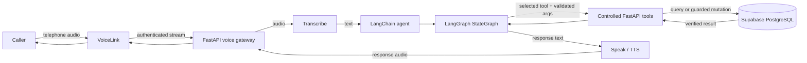

# AI Receptionist

An AI-assisted clinic reception platform for telephone calls, appointment operations, patient and family context, staff workflows, and live conference demonstrations.

The application combines a FastAPI backend, React/Vite staff interface, Supabase PostgreSQL/Auth, VoiceLink telephony, and OpenAI voice engines. It supports both a low-latency Realtime voice path and a Chained speech-to-text → agent → text-to-speech path.

> This repository contains healthcare-adjacent workflow software, not a diagnostic system. The receptionist may route administrative requests, but it must not provide clinical diagnoses or emergency advice.

## What is implemented

- Multi-tenant staff authentication and organization-scoped access.
- Departments, doctors, branches, weekly schedules, exceptions, and generated sessions.
- Appointment availability, preparation, explicit confirmation, cancellation, and rescheduling.
- Transactional booking and capacity protection in PostgreSQL.
- Caller, patient, and family-contact context linked to authenticated telephone metadata.
- Hindi, English, and Hinglish receptionist conversations.
- VoiceLink bidirectional telephone streaming.
- OpenAI Realtime voice processing with declared backend tools.
- Chained transcription, text-agent, and speech synthesis fallback.
- Controlled booking readback, caller confirmation, and barge-in handling.
- Reception dashboard, patient management, configuration, and appointment views.
- Conference Call Observatory with synthetic rehearsal and authenticated LIVE modes.
- Server-sent presentation events with reconnect and last-event cursor support.
- Synthetic conference seeding and deterministic automated tests.

Detailed historical plans and acceptance evidence remain under [`docs/`](docs/). The source code and this README describe the current operational setup.

## System architecture

### Realtime voice path



The backend—not the model—owns authentication, caller identity, tool validation, database access, consent enforcement, and mutation commits.

### Chained voice path



The Chained engine separates the turn into three explicit stages: audio is transcribed, the agent decides what to say or which tool to call, and the response is synthesized back to audio. The agent layer uses **LangChain** (`ChatOpenAI`, messages, and structured tools) and **LangGraph** (`StateGraph`) to enforce the dialogue and booking state machine. Tool execution and database writes remain in FastAPI; LangGraph never receives direct database credentials.

### How the two voice mechanisms differ

| Mechanism | Speech orchestration | Agent/tool orchestration | Best for |
| --- | --- | --- | --- |
| **Realtime** | OpenAI Realtime performs streaming speech in and speech out in one low-latency session. | The Realtime session emits a function call; FastAPI allow-lists, validates, and executes the shared tool, then returns the verified result. | Natural, responsive live telephone conversations. |
| **Chained** | FastAPI runs separate Transcribe and Speak/TTS stages. | LangChain integrates the model and tools; LangGraph coordinates state, confirmation, and guarded booking transitions. | Deterministic workflows, replay, debugging, and scenarios that benefit from explicit turn boundaries. |

Both mechanisms use the same backend business rules, caller context, Supabase data, confirmation requirements, and booking commit guard. The engine is selected once when a call starts and is never silently changed during an active call.

In short:

```text
Realtime: Caller → VoiceLink → FastAPI → OpenAI Realtime ⇄ FastAPI tools → Supabase
Chained:  Caller → VoiceLink → FastAPI → Transcribe → LangChain/LangGraph ⇄ tools → Supabase → Speak
```

Realtime intentionally does not send every audio turn through LangGraph: keeping the streaming loop inside OpenAI Realtime avoids extra latency. LangChain/LangGraph remain the primary orchestration stack for the Chained engine and staff AI assistant, while both paths share the same server-side tool and transaction safety.

## Conference Call Observatory

Open the conference interface at:

```text
http://127.0.0.1:5173/?conference
```

The observatory keeps the architecture fixed while observed signals move through it. It deliberately does not display hidden model reasoning or infer backend operations that were not emitted by the server.

### Observer modes

| Mode | Source | Behaviour |
| --- | --- | --- |
| `REHEARSAL` | Authored synthetic events | Runs without a telephone call and is clearly labelled synthetic. Supports replay, pause, scenarios, seeking, and engine comparison. |
| `LIVE` | Authenticated backend/SSE events | Shows only enrolled real-call activity. It never falls back to synthetic events. |

The observer mode is independent from the voice engine toggle:

- `Realtime` visualizes the continuous OpenAI Realtime audio and tool path.
- `Chained` visualizes Transcribe → Agent → Speak.

### LIVE presentation behaviour

- Polls for enrolled calls and automatically follows active calls only; ended calls require an explicit replay.
- Reconnects SSE using the last observed sequence cursor.
- Detects a missing SSE heartbeat, shows connection health, and reconnects instead of silently freezing.
- Keeps the selected tool visibly marked as `CHOSEN BY ENGINE` during execution.
- Highlights caller speech as `HEARD · PROCESSING` until an assistant response is presented.
- Gives meaningful events a readable visual dwell time while preserving their real order.
- Accelerates transient audio and transcript signals when a backlog becomes large while preserving readable tool and commit states.
- Shows safe tool argument chips and verified results without exposing arbitrary patient payloads.
- Never shows a booking as successful before a committed backend result is observed.
- Supports fullscreen and reduced-motion presentation.

### Observer privacy boundary

LIVE capture is opt-in. A call is observable only when:

1. `PRESENTATION_ENABLED=true`.
2. The caller's exact E.164 number is listed in `PRESENTATION_DEMO_CALLERS`.
3. `VOICE_ORGANIZATION_ID` matches the organization viewed by the signed-in staff member.
4. Voice and presentation routes run in the same backend process.

Presentation traces are bounded, process-local, and expire after approximately one hour. For the current conference setup, run one backend worker and one Azure Container Apps replica so the voice connection and observer read the same in-memory store.

## Repository layout

```text
.
├── backend/                     FastAPI application, voice gateways, tools, and tests
│   ├── app/agent/               LangGraph agent, dialogue policy, and controlled tools
│   ├── app/api/                 HTTP, WebSocket, SSE, and health routes
│   ├── app/integrations/        OpenAI, Twilio, and provider adapters
│   ├── app/services/            Booking, scheduling, maintenance, and health services
│   ├── app/voice/               VoiceLink, Realtime, chained, session, and presentation code
│   ├── scripts/                 Backend smoke checks and provider preflight utilities
│   └── tests/                   Backend unit and integration tests
├── frontend/                    React + TypeScript + Vite staff application
│   ├── src/components/          Dashboard and conference UI
│   ├── src/presentation/        Rehearsal traces, event state, and SSE reader
│   ├── tests/                   Node-based presentation regression tests
│   └── vercel.json              Vercel SPA configuration
├── supabase/
│   ├── migrations/              Ordered owner-run database migrations
│   └── verification/            Read-only post-migration checks
├── scripts/                      Project-level demo and operational scripts
├── docs/                         Deployment, conference, audit, and phase records
├── Dockerfile                    Azure/backend container build from repository root
└── .github/workflows/            CI and Azure deployment workflows
```

## Prerequisites

- Python 3.11–3.14; Python 3.12 is recommended.
- Node.js 22 and npm.
- A Supabase project with PostgreSQL and Auth enabled.
- An OpenAI API key with the required model access.
- A VoiceLink DID and media-stream configuration for telephone calls.
- Optional: Twilio credentials for WhatsApp or the separate Twilio voice path.
- Optional: Cloudflare Tunnel or ngrok for local telephone testing.

## Local setup

The commands below assume PowerShell and the repository root.

### 1. Create the Python environment

```powershell
py -3.12 -m venv .venv
.\.venv\Scripts\Activate.ps1
python -m pip install --upgrade pip
python -m pip install -r backend\requirements.lock -e backend
```

### 2. Configure the backend

```powershell
Copy-Item backend\.env.example backend\.env
```

At minimum, configure the database and Supabase authentication fields in `backend/.env`:

```env
APP_ENVIRONMENT=development
DATABASE_URL=postgresql+asyncpg://...
SUPABASE_URL=https://your-project-ref.supabase.co
SUPABASE_PUBLISHABLE_KEY=your-publishable-key
SUPABASE_JWT_AUDIENCE=authenticated
CORS_ORIGINS=["http://localhost:5173"]
```

Use either Supabase JWKS through `SUPABASE_URL` or the legacy `SUPABASE_JWT_SECRET` configuration. Never put the service-role key in the frontend.

### 3. Configure the frontend

```powershell
Copy-Item frontend\.env.example frontend\.env
```

```env
VITE_API_BASE_URL=http://localhost:8000
VITE_SUPABASE_URL=https://your-project-ref.supabase.co
VITE_SUPABASE_PUBLISHABLE_KEY=your-publishable-key
```

`VITE_*` variables are embedded at build time. Restart Vite after changing them.

### 4. Apply Supabase migrations

Apply files from [`supabase/migrations/`](supabase/migrations/) once in lexical order, then run the matching read-only checks from [`supabase/verification/`](supabase/verification/).

Do not rename or blindly reapply migrations that have already been executed. Confirm the remote migration ledger before repairing migration history.

### 5. Optional: seed the conference fixtures

This script modifies the configured database. Run it only against the intended demo/development organization:

```powershell
.\.venv\Scripts\python.exe scripts\seed_demo_rehearsal.py
```

### 6. Start the backend

```powershell
Set-Location backend
..\.venv\Scripts\python.exe -m uvicorn app.main:app --host 0.0.0.0 --port 8000 --reload
```

Health checks:

```text
http://127.0.0.1:8000/health/live
http://127.0.0.1:8000/health/ready
http://127.0.0.1:8000/docs
```

`/health/live` verifies the process. `/health/ready` also checks required dependencies and may be degraded until the database is configured.

### 7. Start the frontend

In another PowerShell terminal:

```powershell
npm --prefix frontend install
npm --prefix frontend run dev
```

Open:

- Staff application: `http://127.0.0.1:5173/`
- Conference observatory: `http://127.0.0.1:5173/?conference`

## Voice configuration

### Required VoiceLink settings

Configure these values only on the backend:

```env
OPENAI_API_KEY=...
OPENAI_MODEL=gpt-4o-mini
OPENAI_REALTIME_MODEL=gpt-realtime-2.1
OPENAI_REALTIME_VOICE=marin

VOICELINK_PHONE_NUMBER=+91...
VOICELINK_STREAM_SECRET=generate-a-long-random-secret
VOICE_ORGANIZATION_ID=00000000-0000-0000-0000-000000000000
VOICE_ACTOR_ID=00000000-0000-0000-0000-000000000000
VERIFICATION_CODE_PEPPER=generate-another-long-random-secret
```

The production VoiceLink media endpoint is:

```text
wss://<azure-backend-host>/v1/voicelink/media?token=<VOICELINK_STREAM_SECRET>
```

If VoiceLink sends call lifecycle callbacks, use:

```text
https://<azure-backend-host>/v1/voicelink/events?token=<VOICELINK_STREAM_SECRET>
```

Keep the token masked in the VoiceLink portal. Changing `VOICELINK_STREAM_SECRET` requires updating both Azure and VoiceLink.

### Realtime and Chained selection

Use one global engine:

```env
VOICE_ENGINE=realtime
```

or:

```env
VOICE_ENGINE=chained
```

For a controlled Realtime rollout while the default remains Chained:

```env
VOICE_ENGINE=chained
VOICE_REALTIME_CANARY_CALLERS=["+919876543210"]
```

When the canary list is non-empty, listed callers use Realtime and other callers use the configured fallback. Phone numbers must be full E.164 values.

### Enable the LIVE observatory

```env
PRESENTATION_ENABLED=true
PRESENTATION_DEMO_CALLERS=["+919876543210"]
PRESENTATION_SHOW_TRANSCRIPTS=true
```

Use only consented demo callers. Leave transcript capture disabled in ordinary operation unless it is explicitly required and approved.

## Production deployment

The intended topology is:

```text
Vercel frontend → Azure Container Apps backend → Supabase
                                             ↕
                                      VoiceLink WebSocket
                                             ↕
                                      OpenAI voice engine
```

### Azure Container Apps backend

The root [`Dockerfile`](Dockerfile) starts `app.main:app` on the `PORT` environment variable and defaults to port `8002`.

Recommended Azure settings for the current demo architecture:

- External ingress enabled.
- Target port `8002`.
- WebSocket traffic supported through the public HTTPS endpoint.
- Minimum replicas: `1`.
- Maximum replicas: `1` while LIVE presentation storage remains process-local.
- Liveness probe: `GET /health/live`.
- Readiness verification: `GET /health/ready`.

Backend environment variables normally include:

```env
APP_ENVIRONMENT=production
APP_LOG_LEVEL=INFO
DATABASE_URL=...
SUPABASE_URL=https://your-project-ref.supabase.co
SUPABASE_PUBLISHABLE_KEY=...
SUPABASE_JWT_AUDIENCE=authenticated
OPENAI_API_KEY=...
CORS_ORIGINS=["https://your-project.vercel.app","http://localhost:5173"]

VOICELINK_PHONE_NUMBER=+91...
VOICELINK_STREAM_SECRET=...
VOICE_ORGANIZATION_ID=...
VOICE_ACTOR_ID=...
VERIFICATION_CODE_PEPPER=...
VOICE_ENGINE=realtime

PRESENTATION_ENABLED=true
PRESENTATION_DEMO_CALLERS=["+91..."]
PRESENTATION_SHOW_TRANSCRIPTS=true
```

Use exact CORS origins in production. Origins contain only the scheme and host—no path such as `/?conference` and no trailing slash. `CORS_ORIGINS=["*"]` may be useful during diagnosis but should not remain the production policy.

Pushing to the configured GitHub branch triggers the existing Azure deployment workflow. Confirm that the latest Container Apps revision is active before testing a call.

### Vercel frontend

Configure the Vercel project as follows:

- Framework preset: Vite.
- Root directory: `frontend`.
- Build command: `npm run build`.
- Output directory: `dist`.

Required Vercel environment variables:

```env
VITE_API_BASE_URL=https://<azure-backend-host>
VITE_SUPABASE_URL=https://your-project-ref.supabase.co
VITE_SUPABASE_PUBLISHABLE_KEY=your-publishable-key
```

Do not add a trailing slash to `VITE_API_BASE_URL`. Apply the variables to Production and any Preview environments you intend to test, then redeploy because Vite reads them during the build.

The included [`frontend/vercel.json`](frontend/vercel.json) rewrites SPA routes to `index.html`.

### Supabase Auth deployment settings

Add the production Vercel URL to the Supabase Auth site URL/redirect allow-list when using redirect-based authentication. The browser receives only the Supabase URL and publishable key; database credentials and elevated keys remain on the backend.

## Deployment verification

### 1. Backend health

```text
https://<azure-backend-host>/health/live
https://<azure-backend-host>/health/ready
```

Both should report a healthy status before a telephone test.

### 2. Frontend connection

Open the production Vercel application, sign in, and verify that staff data loads without CORS or authentication errors.

### 3. Conference access

Open:

```text
https://<vercel-host>/?conference
```

Select `LIVE`. With no active enrolled call, the expected state is:

```text
Listening for an enrolled telephone call
```

This is not an error and must not switch to synthetic data.

### 4. Real telephone test

1. Call the configured VoiceLink DID from a number in `PRESENTATION_DEMO_CALLERS`.
2. Confirm the VoiceLink stream reaches the Azure WebSocket endpoint.
3. Watch the call appear automatically in LIVE mode.
4. Speak a booking request and verify the caller transcript is highlighted.
5. Verify the selected tool remains visibly marked while FastAPI and Supabase execute it.
6. Confirm that availability is shown as a result, not as a committed booking.
7. Explicitly approve the readback.
8. Verify `CONFIRMED` appears only after the backend transaction commits.
9. Check the appointment in the staff dashboard or database.

## Tests and quality checks

Run from the repository root.

### Frontend

```powershell
npm --prefix frontend run typecheck
node --test frontend/tests/*.test.mjs
npm --prefix frontend run build
```

### Backend

```powershell
.\.venv\Scripts\python.exe -m ruff check backend
.\.venv\Scripts\python.exe -m mypy backend\app
.\.venv\Scripts\python.exe -m pytest backend\tests
```

Some database acceptance tests are intentionally opt-in and may be skipped when a suitable isolated database is not configured.

CI runs backend Ruff, Mypy, Pytest, frontend type checking, presentation tests, and the production frontend build.

## API and transport reference

| Endpoint | Purpose | Authentication |
| --- | --- | --- |
| `GET /health/live` | Process liveness | Public |
| `GET /health/ready` | Dependency readiness | Public |
| `GET /docs` | FastAPI OpenAPI interface | Deployment policy dependent |
| `WS /v1/voicelink/media?token=...` | VoiceLink bidirectional audio | Shared VoiceLink stream secret |
| `POST /v1/voicelink/events?token=...` | VoiceLink lifecycle callback | Shared VoiceLink stream secret |
| `GET /v1/presentation/calls` | List observable calls for an organization | Supabase bearer token + active membership |
| `GET /v1/presentation/calls/{call_id}/events` | SSE presentation stream | Supabase bearer token + active membership |
| `WS /v1/twilio/media` | Signed Twilio media stream | Twilio signature and call binding |

Business APIs for identity, configuration, patients, availability, bookings, and the text agent are documented by the running application at `/docs`.

## Safety and correctness guarantees

- Caller identity comes from authenticated carrier metadata, not model-provided phone numbers.
- Tool names are allow-listed and validated by FastAPI.
- Arbitrary model arguments never receive direct database access.
- Consequential operations require server-controlled confirmation state.
- Booking success is emitted only after a verified commit.
- Failed or preview operations are never presented as successful bookings.
- The observatory does not display hidden chain-of-thought or fabricate unobserved activity.
- Presentation argument/result payloads are allow-listed and redacted.
- Call traces contain no audio payloads.
- Organization membership is checked before LIVE calls can be listed or followed.
- Secrets stay on the backend; browser configuration uses only publishable values.

## Troubleshooting

### Vercel still uses localhost

- Confirm `VITE_API_BASE_URL` is set for the correct Vercel environment.
- Remove any trailing slash.
- Redeploy after changing the variable.
- Inspect the deployment created from the latest Git commit, not an older preview.

### Browser reports a CORS error

- Set Azure `CORS_ORIGINS` to the exact Vercel production origin.
- Do not include a path or trailing slash.
- Save the change and confirm the new Container Apps revision is active.

### LIVE mode shows no calls

Check all of the following:

- `PRESENTATION_ENABLED=true` on the active Azure revision.
- The calling number exactly matches an E.164 value in `PRESENTATION_DEMO_CALLERS`.
- `VOICE_ORGANIZATION_ID` is the organization opened by the signed-in user.
- The user has an active organization membership.
- VoiceLink is connected to the same backend deployment serving presentation APIs.
- Azure is running one replica for the process-local observer.
- The call started after the environment update/revision restart.

### LIVE returns 401 or 403

- Sign out and sign in again to refresh the Supabase access token.
- Confirm the user has an active membership in `VOICE_ORGANIZATION_ID`.
- Confirm Vercel uses the same Supabase project as Azure.

### VoiceLink cannot connect

- Confirm the URL uses `wss://` and `/v1/voicelink/media`.
- Confirm the query token matches `VOICELINK_STREAM_SECRET` exactly.
- Confirm Azure ingress targets container port `8002`.
- Confirm the latest backend revision is healthy.
- Confirm `DATABASE_URL`, `VOICE_ORGANIZATION_ID`, `VOICE_ACTOR_ID`, and `VERIFICATION_CODE_PEPPER` are set.

### Realtime calls fall back to Chained

- Confirm `VOICE_ENGINE=realtime`, or add the caller to `VOICE_REALTIME_CANARY_CALLERS`.
- Confirm `OPENAI_API_KEY`, `OPENAI_REALTIME_MODEL`, and `OPENAI_REALTIME_VOICE` are configured.
- Use full E.164 values in the canary list.
- Engine selection occurs only at call start; place a new call after changing configuration.

### The observatory appears behind the call

LIVE mode intentionally gives semantic events a short visual dwell time so the flow can be understood. A small queued-signal label appears when events arrive faster than they can be presented. The display catches up automatically without changing event order.

## Operational documentation

- [`docs/CONFERENCE_RUNBOOK.md`](docs/CONFERENCE_RUNBOOK.md) — demo data and conference scenarios.
- [`docs/AZURE_VERCEL_DEPLOYMENT_GUIDE.md`](docs/AZURE_VERCEL_DEPLOYMENT_GUIDE.md) — detailed Azure and Vercel deployment steps.
- [`docs/VOICE_AGENT_INDUSTRY_UPGRADE_PLAN.md`](docs/VOICE_AGENT_INDUSTRY_UPGRADE_PLAN.md) — voice architecture decisions and implementation record.
- [`docs/PROJECT_AUDIT_2026-09-12.md`](docs/PROJECT_AUDIT_2026-09-12.md) — historical code and product audit.
- [`docs/phase-2/G2_EVIDENCE.md`](docs/phase-2/G2_EVIDENCE.md) — transactional booking evidence.
- [`docs/phase-6/STATUS.md`](docs/phase-6/STATUS.md) — historical voice milestone record.

## Contribution workflow

1. Create a focused branch.
2. Keep secrets and local `.env` files out of Git.
3. Add tests for behaviour changes.
4. Run frontend and backend checks.
5. Review migrations before applying them to shared environments.
6. Open a pull request and allow CI to complete.
7. Verify both Vercel and Azure deployments when merging to the deployment branch.

## License

No open-source license has been declared in this repository. Treat the code as private/proprietary unless the repository owner adds a license.
