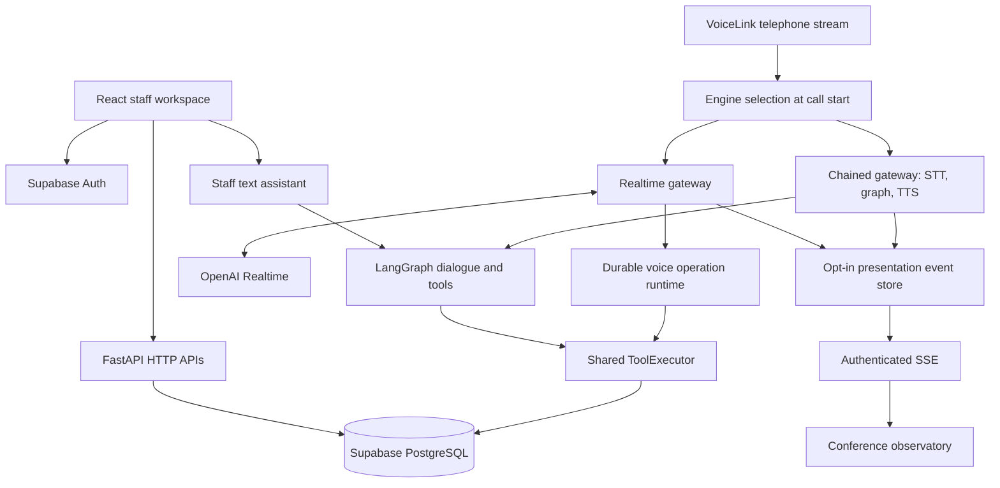

# Project code review — 26 September 2026

This is a repository-wide code review of the local checkout. The application has substantial working functionality and good tests around its newer Realtime booking state machine. Its main weakness is inconsistent behavior across entry points: the database, Realtime gateway, Chained agent, and staff interface do not always enforce or display the same rules.

The review covered the application structure, HTTP and voice entry points, authentication, scheduling, booking transactions, caller identity, confirmation, presentation telemetry, frontend data flows, SQL migrations, tests, scripts, and deployment configuration. All 205 tracked paths were inventoried. Generated files, installed dependencies, caches, and private environment-file contents are outside the code inventory. The accompanying [code map](E:/Projects/Ai_receptionist/docs/PROJECT_CODE_MAP_2026-09-26.md) indexes the files and declared API routes.

Application behavior was not changed. Findings below distinguish local reproductions from conclusions based on source inspection. No remote migrations, seed scripts, telephone calls, provider smoke tests, or deployments were run. The configured production database and external provider behavior were not verified.

**Repository size and technology**

Counts describe the tracked checkout before adding these review documents. Line counts include blank lines and comments.

| Area | Files | Lines | Main technology |
| --- | ---: | ---: | --- |
| Backend application, including prompt and package files | 69 | 11,559 | Python, FastAPI, async SQLAlchemy, asyncpg, Pydantic |
| Backend tests | 32 | 6,196 | Pytest, pytest-asyncio, provider/database doubles |
| Frontend source | 20 | 3,403 | React 18, TypeScript, Fluent UI, CSS |
| Database migrations | 17 | 2,081 | PostgreSQL functions, triggers, RLS, constraints |
| SQL verification | 10 | 195 | Read-only schema/behavior checks |
| SQL seeds | 4 | 351 | Synthetic demo setup and cleanup |
| Other tracked files | 53 | 8,526 | Documentation, dependencies, scripts, CI, containers |

There are 24 declared application tables and 43 router-decorated endpoints across the API modules; four endpoints belong to the separate Sarvam application. The default application mounts the other 39. Backend tests contain 184 test functions, expanded by parameterization into 269 collected cases.

**How the system works**

The important distinction is between shared business tools and shared authorization. Both voice engines use the tools, but only the Realtime path integrates the newer durable runtime and carrier-acknowledged readback flow.

**Backend map and responsibilities**

| Area | Responsibility | Assessment |
| --- | --- | --- |
| `app/main.py` | Main app, CORS, error handling, router mounting, maintenance lifecycle | Clear composition root; readiness and maintenance need attention |
| `core/` | Environment settings, API errors, logging, correlation IDs | Typed configuration; several production constraints remain operational rather than enforced |
| `security/auth.py` | Validates bearer tokens through Supabase Auth or JWT/JWKS | Backend authentication exists; normal configured path makes a remote Auth request for every authenticated request |
| `db/session.py`, `repositories/memberships.py` | Async sessions and active tenant membership | Small and understandable; most data access otherwise lives directly in routes/tools |
| `api/routes/configuration.py` | Organization, branch, department, doctor assignment, schedule and exception changes | Admin checks and tenant filters; tightly coupled SQL and orchestration |
| `api/routes/patients.py` | Directory, caller lookup, patient/contact updates, archival and hard deletion | Strong identity separation, but broad permanent-delete capability |
| `api/routes/bookings.py` | Intake, session choices, holds, confirmation, cancellation, rescheduling, visit state | Parameterized queries and database functions; read models and rescheduling have gaps |
| `services/schedule_generation.py` | Materializes weekly rules and rebuilds future unbooked sessions | Preserves booked sessions; lacks a rolling scheduled invocation |
| `agent/graph.py`, `dialogue.py`, `policy.py` | Tool graph, text confirmation, bilingual dialogue policy | Booking gate exists; cancellation/rescheduling gates are incomplete |
| `agent/tools.py` | Discovery, caller/family lookup, verification, signed offers and writes | Central business integration point; 1,708 lines makes behavior changes difficult to isolate |
| `voice/voicelink_realtime_gateway.py` | Realtime startup, media bridge, tools, interruptions, readbacks, caller intent | Most developed voice path; 1,037 lines and several missing operation-result paths |
| `voice/voicelink_gateway.py` | A-law capture, turn queue, transcription, graph calls and TTS | Separate implementation with weaker confirmation evidence and unconditional transcript logging |
| `voice/call_runtime.py`, `session.py`, `session_store.py`, `agent/operation_service.py` | Persisted call state, optimistic versioning, ownership, atomic operations | Strong foundation; session lifecycle and multi-operation reconciliation remain incomplete |
| `voice/readback*`, `proposals.py`, `caller_items.py`, `confirmation_intent.py` | Playback evidence, proposal fingerprints, ordered caller speech and semantic consent | Useful separation from the conversation model; intent classification is still a model-dependent decision |
| `voice/presentation.py`, `api/routes/presentation.py` | Enrolled-call capture, redaction, bounded storage and authorized streaming | Good isolation from booking; deliberately process-local |
| `integrations/` and `voice/codec.py` | Provider HTTP/WebSocket clients, A-law/mu-law/PCM conversion | Small provider adapters; custom audio processing has dedicated tests |
| `voice_main.py`, `voicelink_main.py`, `sarvam_main.py` | Alternative deployment entry points | Different middleware/lifecycle coverage; do not treat them as equivalent to `main.py` |

**Data model and transactional behavior**

The schema separates organizations and staff memberships from global doctors and tenant-specific doctor assignments. Weekly schedule rules and exceptions generate appointment sessions; exact-time slots remain in the model for historical compatibility, while current configuration APIs and the latest rule constraint allow only session-token rules.

Caller identity is modeled as contacts and active phone numbers. Patients are separate records connected through explicit family relationships. An active phone is unique within an organization, and a contact can have only one recorded SELF relationship. Appointment-specific permissions are distinct from family relationships.

Appointments carry booking references, status, optimistic versions, optional queue tokens, payment records, and quote/contact/consent snapshots. The hold function locks a session before checking token capacity. Exact-time occupancy has a partial unique index. Confirmation allocates tokens under a session lock. Tenant-qualified foreign keys protect many cross-table relationships. SQL functions use explicit authorization and an empty search path.

Realtime operations add persisted call sessions and operation records. The runtime checks the active proposal, fingerprints the signed offer or arguments, verifies that approval speech began after readback completion, and commits appointment changes and operation evidence in the same transaction. An uncertain booking commit is fenced against replay; positive evidence can be read in a fresh session. These are valuable protections and should become the common mutation boundary for every voice path.

The direct SQL connection is important: setting `request.jwt.claim.sub` supplies identity to SQL functions but does not itself change the PostgreSQL role to `authenticated`. Effective RLS enforcement depends on the deployed database role. Many reads rely on explicit tenant and membership checks, and several reads do not set the JWT claim. The actual connection role and grants require deployment verification; this review does not claim RLS is enforced for every backend query.

**Frontend map**

| File/component | Behavior |
| --- | --- |
| `App.tsx` | Authentication, first-membership selection, workspace loading, six-second polling, navigation, booking/cancel/reschedule handlers |
| `lib/supabaseAuth.ts` | Custom password login and localStorage session restoration; no refresh-token exchange |
| `OverviewPage` | Derives operational counts and upcoming arrivals from the loaded appointment array |
| `AvailabilityPage` | Doctor cards, weekly rule summary and week calendar |
| `BookingPage` | Session selection, caller/patient details and simulated/manual payment choice |
| `AppointmentsManager` | Client-side filtering, arrival/outcome actions, cancel/reschedule controls |
| `PatientsPage` | Caller-family groups, edit workflow, hard-delete flow |
| `AdminSettingsPage` | Departments, doctor fees, weekly hours, clinic and first-location editing |
| `AiAssistantPage` | Creates a text-agent thread per component mount and refreshes data after confirmed changes |
| `PresentationPage`, `Observatory` | Rehearsal/live modes, architecture view, event pacing, inspector, subtitles and fullscreen |
| `presentation/state.ts`, `trace.ts` | Deterministic event reduction, synthetic scenarios, SSE parsing/reconnection and heartbeat handling |
| Stylesheets | Global staff layout plus four presentation stylesheet layers |

The frontend has TypeScript strict mode, but `Dashboard(props: any)` weakens the main component contract. Shared API calls, domain types, currency formatting and timezone handling are duplicated. `App.tsx` still contains unused legacy calendar/appointment/settings implementations. The installed Supabase JS client is not used by the custom authentication helper. These are maintainability issues rather than reasons to rewrite the application.

**Findings that should drive the next changes**

Priorities are implementation priorities: P1 should be addressed before relying on the affected flow for ordinary operations; P2 is a concrete correctness or operational gap. Runtime reproductions used only synthetic objects and mocks.

| ID | Priority | Finding | Evidence and effect |
| --- | --- | --- | --- |
| F01 | P1 | Chained/text mutations do not share Realtime's consent boundary | [graph.py:410](E:/Projects/Ai_receptionist/backend/app/agent/graph.py:410), [service.py:63](E:/Projects/Ai_receptionist/backend/app/agent/service.py:63), [voicelink_gateway.py:568](E:/Projects/Ai_receptionist/backend/app/voice/voicelink_gateway.py:568). Graph checks are specific to `confirm_booking_offer`; cancellation/rescheduling go directly to tools. A local fake-model probe executed both tools after the user text “Do not change anything. Explain the cancellation policy.” This demonstrates missing enforcement, not a claim that a real model always chooses those tools. Chained booking additionally marks an offer presented when text is produced, before TTS playback is acknowledged; queued/overlapping speech is not tied to readback completion. |
| F02 | P1 | Fee input and display use rupees while the voice path uses paise | [AdminSettingsPage.tsx:161](E:/Projects/Ai_receptionist/frontend/src/components/AdminSettingsPage.tsx:161), [AdminSettingsPage.tsx:302](E:/Projects/Ai_receptionist/frontend/src/components/AdminSettingsPage.tsx:302), [readback_text.py:42](E:/Projects/Ai_receptionist/backend/app/voice/readback_text.py:42). Entering 500 into “Consultation fee (INR)” stores `fee_minor=500`; the readback correctly interprets that as 5 rupees. Appointment and doctor displays also render the raw minor amount. The voice-formatting discrepancy was reproduced locally. |
| F03 | P1 | Realtime cancellation/rescheduling does not deliver the result to the model | [voicelink_realtime_gateway.py:757](E:/Projects/Ai_receptionist/backend/app/voice/voicelink_realtime_gateway.py:757). After success the handler only sends `response.create` asking the model to report a server-confirmed result; it never inserts that result or the replacement reference into the conversation. On `ok=False`, it clears pending state and sends no response. Mocked success/failure probes confirmed one instruction-only event versus zero events. The booking handler already has a fuller result-delivery pattern to follow. |
| F04 | P1 | The SQL reschedule function permits destinations the voice tool rejects | [rescheduling migration:24](E:/Projects/Ai_receptionist/supabase/migrations/20260911000600_phase2_rescheduling.sql:24), [bookings.py:578](E:/Projects/Ai_receptionist/backend/app/api/routes/bookings.py:578). SQL checks target session status and capacity but not its booking cutoff or active assignment/location. The staff endpoint calls it directly. A past session still marked SCHEDULED/OPEN can therefore pass these source-level checks. The voice tool's preliminary cutoff check does not protect the staff path or direct RPC. This was not executed against a database. |
| F05 | P1 | Rescheduling retains the old quote and consent and loses payment visibility | [rescheduling migration:40](E:/Projects/Ai_receptionist/supabase/migrations/20260911000600_phase2_rescheduling.sql:40). The replacement copies `old_row.quote_snapshot` and `old_row.consent_snapshot` even when the date, doctor or branch changes. No replacement payment record or explicit payment linkage is created; the list API joins payments by replacement appointment ID. Monetary comparison checks the numeric fee without comparing currency. Source inspection establishes the mismatch; database acceptance remains required. |
| F06 | P1 | Readiness can report success without usable PostgreSQL | [health.py:8](E:/Projects/Ai_receptionist/backend/app/services/health.py:8), [health route:15](E:/Projects/Ai_receptionist/backend/app/api/routes/health.py:15). Failed or missing SQL connectivity falls back to the Supabase Auth settings endpoint. A successful HTTPS response becomes healthy readiness even though booking uses direct SQL. A local mock with `database_url=None` returned `(True, 'supabase_https_ready')`; the route discards the detail. |
| F07 | P1 | Weekly availability is not continuously extended | [configuration.py:473](E:/Projects/Ai_receptionist/backend/app/api/routes/configuration.py:473), [maintenance.py:12](E:/Projects/Ai_receptionist/backend/app/services/maintenance.py:12). Configuration changes rebuild through today plus 14 days, and an explicit admin generate endpoint exists. No application background job extends that horizon: maintenance only expires holds/challenges. Without an external scheduler or further admin changes, availability eventually runs out despite active recurring rules. |
| F08 | P2 | Browser sessions cannot refresh | [supabaseAuth.ts:13](E:/Projects/Ai_receptionist/frontend/src/lib/supabaseAuth.ts:13). Refresh tokens are stored but never used. `restoreSession` only calls `/auth/v1/user` with the existing access token and returns null on failure. A mocked expired-token response produced null with no refresh request. Long-running staff and live-observer sessions will fail when the access token expires. |
| F09 | P2 | Polling overwrites search and can overwrite the selected session | [App.tsx:89](E:/Projects/Ai_receptionist/frontend/src/App.tsx:89). The interval/focus handlers call `loadAppointments` without the active search. They also close over the `selectedSessionId` from the render when the effect started; that value is absent from the dependencies. With the initial empty selection, a later poll resets the chosen booking session to the first result. Rejected polling promises have no catch. |
| F10 | P2 | The dashboard treats the latest 50 records as the complete dataset | [bookings.py:380](E:/Projects/Ai_receptionist/backend/app/api/routes/bookings.py:380), [App.tsx:77](E:/Projects/Ai_receptionist/frontend/src/App.tsx:77). The API always limits to 50 ordered by creation time and returns no cursor/total. The UI derives today's queues, upcoming visits and history counts from that subset. Older-created appointments can disappear from today's view after sufficient newer bookings. |
| F11 | P2 | Overview counters use statuses the backend does not produce | [OverviewPage.tsx:76](E:/Projects/Ai_receptionist/frontend/src/components/OverviewPage.tsx:76), [bookings.py:407](E:/Projects/Ai_receptionist/backend/app/api/routes/bookings.py:407). `today` is already restricted to CONFIRMED appointments, then completion is counted using queue status COMPLETED. The backend uses appointment status COMPLETED and queue status SERVED. The review queue looks for HELD/PENDING, while holds are PAYMENT_PENDING. |
| F12 | P2 | Chained transcripts and replies enter ordinary logs regardless of observer settings | [voicelink_gateway.py:550](E:/Projects/Ai_receptionist/backend/app/voice/voicelink_gateway.py:550), [voicelink_gateway.py:606](E:/Projects/Ai_receptionist/backend/app/voice/voicelink_gateway.py:606). Full transcripts and replies are logged at INFO; echo suppression also logs transcript text. Presentation enrollment and transcript flags do not govern these logs. Patient/family information can therefore be retained outside the observer's bounded store. |
| F13 | P2 | Voice bookings are recorded as AI_TEXT | [tools.py:1325](E:/Projects/Ai_receptionist/backend/app/agent/tools.py:1325). The common confirmation tool hardcodes both booking source and consent channel to AI_TEXT, including when called by the Realtime runtime. Operational attribution and consent evidence cannot distinguish actual telephone bookings. |
| F14 | P2 | Outbox infrastructure has no application dispatcher | [durable side-effects migration:80](E:/Projects/Ai_receptionist/supabase/migrations/20260911001200_phase2_durable_booking_side_effects.sql:80), [maintenance.py:12](E:/Projects/Ai_receptionist/backend/app/services/maintenance.py:12). SQL can enqueue, lease, retry and complete jobs, but no runtime code calls the claim/complete/fail functions. The Twilio sender is used for verification, not a booking-notification worker. Durable job creation alone does not deliver notifications. |
| F15 | P2 | Call lifecycle persistence is incomplete | [session_store.py:49](E:/Projects/Ai_receptionist/backend/app/voice/session_store.py:49), [voicelink_realtime_gateway.py:354](E:/Projects/Ai_receptionist/backend/app/voice/voicelink_realtime_gateway.py:354). Sessions expire 15 minutes after creation. Saves permit expiry renewal, but runtime calls never supply it. Cleanup closes connections without persisting ENDED, and no cleanup job updates/deletes expired call rows. Reconnecting with the same provider call ID attempts a fresh insert against a unique key. |
| F16 | P2 | Ordinary patient deletion is a permanent multi-record purge | [PatientsPage.tsx:135](E:/Projects/Ai_receptionist/frontend/src/components/PatientsPage.tsx:135), [patients.py:325](E:/Projects/Ai_receptionist/backend/app/api/routes/patients.py:325). The UI always requests hard deletion; backend authorization admits receptionists as well as admins. Deleting SELF can remove related family profiles, appointments and payment rows. There is a confirmation dialog, so the action is not hidden, but archival exists and is bypassed. An explicit product decision and stronger separation from ordinary reception are warranted. |
| F17 | P2 | Backend deployment is not gated on CI in the repository | [deployment workflow:5](E:/Projects/Ai_receptionist/.github/workflows/ai-receptionist-backend-AutoDeployTrigger-d2b084f2-4c49-4354-be5c-ae075cc99ad2.yml:5), [ci.yml:1](E:/Projects/Ai_receptionist/.github/workflows/ci.yml:1). Both independently trigger on main pushes. Deployment can proceed while checks run or fail. The warm-instance step enforces only minimum replicas, not the maximum of one required by process-local observation. Remote branch protection and replica settings were not inspected. |
| F18 | P2 | Migration versions collide | Both `20260911001400_india_localization.sql` and `20260911001400_phase2_session_windows_only.sql` use the same version prefix. Manual lexical application can execute both, but this is ambiguous for version-based migration tracking. Check the actual remote ledger before repairing filenames/history. |

**Additional limitations and integration details**

- Realtime cancellation/rescheduling readback includes reference, patient and doctor, but the reschedule text only says “the selected session”; it omits the new date/time and branch. See [gateway readback:832](E:/Projects/Ai_receptionist/backend/app/voice/voicelink_realtime_gateway.py:832). Bind complete destination details to the confirmed proposal.
- Realtime booking has uncertain-commit reconciliation support; cancellation/rescheduling do not have corresponding persisted-result recovery helpers. The runtime safely fences an uncertain commit, but recovery is incomplete.
- LangGraph uses a global `InMemorySaver` without a retention/eviction policy. Threads are tenant/actor/thread namespaced, which is good, but conversation history is lost on restart and grows during the worker lifetime. Multiple workers do not share it.
- Telephone routing is a single configured organization and actor per deployment. HTTP tenancy does not imply a multi-tenant DID routing system.
- The frontend selects `memberships[0]` and has no organization switcher. VIEWER exists in the schema but workspace startup requests staff-only booking data and can fail. Admin navigation is visible to receptionists even though mutations correctly fail server-side.
- Week navigation changes the rendered dates but the query window remains now through 14 days. Going farther forward/backward shows missing sessions rather than loading the chosen range.
- The manual booking page retains exact-time types and slot state but has no visible slot selector. Current rules prohibit creating new exact-time schedules; decide whether historical exact-time booking remains supported before removing or completing this path.
- Clinic names and example doctors remain hardcoded in Chained prompts, the Chained greeting, Twilio greeting, and transcription hints. Realtime has a better database-driven clinic identity path.
- Appointment visit actions use `try/finally` without a catch in `AppointmentsManager`; API conflicts can become unhandled promises with no visible error. Patient and clinic editing each use multiple separate requests, so a later failure can leave a partial update.
- Direct source-level role checks are duplicated between route modules. New operations can easily omit a check or use a different policy unless these are consolidated.
- The database has an immutable audit-events table, but application mutation paths do not consistently append general audit events. A schema foundation is not full audit coverage.
- Payment flows remain explicitly simulated. There is no live payment collection, settlement, refund integration or completed human-transfer workflow. `FALLBACK_RECEPTIONIST_NUMBER` does not by itself implement transfer.
- No application-level rate limiter, bounded per-tenant AI concurrency controller, or validated capacity benchmark was found. Existing turn queues and message-size checks protect parts of an individual call, not overall service admission.
- Root and backend Dockerfiles are nearly identical, run as the image's default root user, and install the shared requirements lock including development tools. A root-context `.dockerignore` is absent. Their explicit COPY statements do not copy local `.env` files into the application image; unnecessary build-context transfer is a separate concern.

**Tests and validation actually run**

| Check | Result |
| --- | --- |
| `python -m ruff check backend` | Passed; one filesystem-access warning while walking an inaccessible local directory |
| `python -m mypy backend/app` | Passed for 68 Python source files |
| Backend suite with `RUN_G2_INTEGRATION_TESTS=0` | 256 passed, 8 skipped, 5 fixture setup errors caused by Windows temporary-directory permissions |
| Rerun of the five health/auth tests outside the sandbox | 5 passed; local pytest cache write warning remained |
| Combined backend result | 261 passing cases, 8 deliberately skipped database cases; no test assertion failures |
| Frontend TypeScript check | Passed |
| Frontend presentation tests | 11 passed |
| Frontend production build | Passed; JS 462.72 kB / 123.34 kB gzip; CSS 82.92 kB / 17.69 kB gzip |
| Mocked graph mutation probes | Confirmed cancellation and rescheduling dispatch without an approval gate |
| Mocked Realtime operation result probes | Confirmed success sends only a generic response instruction; failure sends nothing |
| Mocked readiness probe | Confirmed healthy result without DATABASE_URL when Auth HTTPS succeeds |
| Mocked browser session probe | Confirmed expired access token returns null without refresh-token exchange |
| Fee-formatting probe | Confirmed 500 minor units are spoken as 5 rupees |

The eight skipped cases are significant: they cover actual SQL transaction behavior, capacity contention, idempotency, permissions and related database guarantees. CI does not provision an isolated Supabase-compatible database or enable that suite. Passing unit tests cannot establish those guarantees against the currently deployed schema.

The strongest automated coverage is around voice proposal state, playback acknowledgment, stale/early approval, event ordering, audio handling, graph booking consent, and presentation reconnection. Frontend tests concentrate on presentation state/transport; they do not exercise sign-in expiry, booking selection under polling, fees, appointment pagination, patient edits, or staff role behavior. Some checks inspect source strings, which is useful for wiring but weaker than user-flow testing.

**Scripts and operational assets**

Provider preflight/audio/WebSocket scripts are diagnostic tools, not tests of a local-only pure function. Some contact external services or use billable model/telephone operations. `configure_twilio_voice.py` changes provider routing; `configure_voicelink_env.py` and `discover_sarvam_voice.py` can write environment configuration; `start_test_voice_call.py` initiates an outbound call. These were inspected but not executed.

The rehearsal Python script and SQL seeds create or modify demo records. The stray-test cleanup seed deletes records. The India localization migration also changes named demo organizations and currency/phone data. Keep those operational effects distinct from schema-only deployment. No demo/setup/cleanup script was run in this review.

The README is the best current overview, while the PRD, implementation summary, phase records, old audit and voice-upgrade plan mix historical targets and completed work. The previous audit is useful background, but its findings are not assumed to remain true: this review independently traced the current paths. The README's assertion that both engines share the same booking commit guard needs correction until F01 is resolved. The assistant UI also says cancellation/rescheduling remain with reception even though the text graph exposes those tools.

**Recommended implementation sequence**

1. Make consent enforcement common across Realtime, Chained, and staff AI. Block consequential tool dispatch without the appropriate server-owned proposal and later approval. For telephone flows, require completed playback evidence.
2. Correct currency conversion and reconcile existing demo fee values deliberately. Do not blindly multiply all stored values: the database may contain a mixture of correctly and incorrectly entered amounts.
3. Complete Realtime cancellation/rescheduling: full readback, verified result injection, explicit failure response, and uncertain-commit recovery.
4. Move all booking/rescheduling invariants into transactional services/SQL: cutoff, active destination, currency, fresh quote/consent and explicit payment linkage.
5. Fix readiness and implement rolling schedule generation. Exercise the real SQL suite against an isolated migrated database, then make it a CI gate.
6. Fix browser refresh, polling closure/search behavior, pagination and dashboard status mapping. Add interaction tests for these failures.
7. Establish one transcript logging/retention policy; persist call closure/expiry; either finish notification dispatch or keep it explicitly unavailable.
8. Gate deployment on successful checks and enforce the intended single-worker/single-replica topology until shared observation/checkpoint storage is implemented.
9. Refactor incrementally: central API/auth client and domain types in React; common authorization dependencies; focused discovery, identity, booking and notification services behind ToolExecutor. Preserve the tested runtime/state-machine modules.

This is a capable single-clinic demo and a useful foundation for a reception product. The next work should close the inconsistent execution paths and staff-workflow defects before adding more provider integrations or presentation features.
